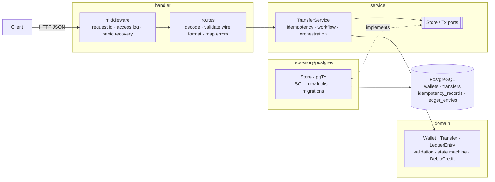

# Wallet Transfer Service — Design

## 1. Problem statement

Move money between two wallets such that:

- a request carrying an `idempotencyKey` takes effect **at most once** and every
  retry of it returns the **original result** (exactly-once at the API level);
- every successful transfer is recorded as a **double-entry** pair (one DEBIT,
  one CREDIT, same amount) and the ledger always balances;
- wallet balances stay correct and never go negative under **concurrent**
  requests (no double spending);
- a transfer moves through an explicit state machine
  (`PENDING -> PROCESSED | FAILED`) whose transitions are safe under retries.

Out of scope: multi-currency, FX, authn/authz, wallet funding flows,
reversals/refunds, and server-side recovery of `PENDING` transfers after a
process crash (recovery is client-driven via retry; see §8).

## Architecture



Dependencies point inwards: `handler → service → domain`. The repository
implements the ports defined by the service, so the service has no SQL in it
and can be tested against a fault-injecting wrapper of the real store.

## 2. Domain model

| Concept       | Notes |
|---------------|-------|
| Wallet        | `id`, `balance` (int64 minor units), `opening_balance`. Balance must never be negative. |
| Transfer      | `id` (UUID), `from_wallet_id`, `to_wallet_id`, `amount > 0`, `status`, `failure_reason`. `from != to`. |
| LedgerEntry   | `wallet_id`, `transfer_id`, `type` (`DEBIT`/`CREDIT`), `amount > 0`. Exactly one of each type per processed transfer. |
| Idempotency record | `key` → `request_hash`, `transfer_id`. Binds a key to one request payload and one transfer. |

### Transfer state machine

```
          MarkProcessed()
PENDING ─────────────────▶ PROCESSED   (terminal)
   │
   └────────────────────▶ FAILED      (terminal)
          MarkFailed(reason)
```

Any other transition (`PROCESSED -> *`, `FAILED -> *`, `PENDING -> PENDING`)
returns `ErrInvalidTransition`. The domain object enforces this in memory; the
repository additionally enforces it in SQL with a guarded update
(`UPDATE ... WHERE id = $1 AND status = 'PENDING'`), so even a buggy caller
cannot move a terminal transfer.

## 3. API contract

All bodies are JSON.

**Money convention.** `amount` and balances are JSON integers in the minor unit
of the single system currency (e.g. paise for INR, cents for USD), so `100`
means ₹1.00. They are `int64` end to end (`BIGINT` in Postgres); floating point
is never used. A non-integer (`1.5`) or string amount is rejected with `400`.

**Validation rules**

| Field | Rule |
|-------|------|
| `fromWalletId`, `toWalletId` | required, 1–64 chars, `[A-Za-z0-9_-]`, must differ |
| `amount` | required, integer, `> 0` |
| `idempotencyKey` | optional; if present 1–255 visible ASCII chars, no spaces (a UUID is recommended) |
| body | single JSON object, ≤ 64 KiB, unknown fields rejected |
| `{id}` in `/transfers/{id}` | must be a UUID, otherwise `404` |

**Error format.** Every non-2xx response, including unknown routes (`404`) and
wrong methods (`405`), has the same shape:

```json
{"error": {"code": "VALIDATION_ERROR", "message": "amount must be a positive integer"}}
```

Codes: `INVALID_JSON`, `VALIDATION_ERROR`, `WALLET_NOT_FOUND`,
`TRANSFER_NOT_FOUND`, `WALLET_EXISTS`, `IDEMPOTENCY_KEY_REUSED`, `NOT_FOUND`,
`METHOD_NOT_ALLOWED`, `INTERNAL_ERROR` (details are logged, never returned).

Every response carries `X-Request-ID`: the caller's value if it is well-formed,
otherwise a generated UUID.

### `POST /transfers`

Request:

```json
{
  "idempotencyKey": "abc123",      // optional
  "fromWalletId": "wallet_1",
  "toWalletId": "wallet_2",
  "amount": 100
}
```

Response body (all outcomes that produced a transfer):

```json
{
  "id": "7f1c…",
  "idempotencyKey": "abc123",
  "fromWalletId": "wallet_1",
  "toWalletId": "wallet_2",
  "amount": 100,
  "status": "PROCESSED",          // or FAILED
  "failureReason": "",             // e.g. INSUFFICIENT_FUNDS when FAILED
  "createdAt": "…",
  "updatedAt": "…"
}
```

| Situation | HTTP | Body |
|-----------|------|------|
| Transfer processed | `201 Created` | transfer, `status=PROCESSED` |
| Business rule failure (insufficient funds) | `422 Unprocessable Entity` | transfer, `status=FAILED` |
| Replay of an earlier request with same key + same payload | same code as the original | same transfer; header `Idempotent-Replayed: true` |
| Same key, different payload | `409 Conflict` | `{"error": {"code": "IDEMPOTENCY_KEY_REUSED", …}}` |
| Malformed JSON / validation error (amount ≤ 0, from == to, missing ids) | `400 Bad Request` | error |
| Wallet does not exist | `404 Not Found` | error |
| Unexpected/DB error | `500` | error |

Validation and not-found errors happen **before** anything is persisted, so they
do not consume the idempotency key: a client may fix the request and retry with
the same key.

### `GET /transfers/{id}`

Returns the transfer, `404` if unknown.

### `GET /wallets/{id}`

Returns `{"id", "balance", "createdAt", "updatedAt"}`.

### `POST /wallets`

`{"id": "wallet_1", "initialBalance": 1000}` → `201`. Test/bootstrap
convenience only (see assumptions); `409` if the id exists.

### `GET /wallets/{id}/ledger`

Returns ledger entries of the wallet, oldest first.

## 4. Transfer workflow

The workflow is two short database transactions:

**Tx 1 — Accept (create the intent)**

1. Verify both wallets exist (`404` otherwise; nothing persisted).
2. `INSERT` transfer in `PENDING`.
3. If a key was supplied:
   `INSERT INTO idempotency_records … ON CONFLICT (key) DO NOTHING`.
   - Inserted → commit; continue to Tx 2 with the new transfer.
   - Conflict → roll back (discarding our `PENDING` row), read the existing
     record. Different `request_hash` → `409`. Same hash → continue to Tx 2
     with the **existing** transfer id.

**Tx 2 — Process**

1. `SELECT … FROM transfers WHERE id = $1 FOR NO KEY UPDATE`.
   If already terminal → return it unchanged (replay). This lock serialises
   concurrent processors of the same transfer.
2. `SELECT … FROM wallets WHERE id IN ($from, $to) ORDER BY id FOR NO KEY UPDATE`
   — both wallets locked in a deterministic order (deadlock-free).
3. If `balance(from) < amount` → mark `FAILED/INSUFFICIENT_FUNDS`, commit.
4. Otherwise: debit source, credit destination, insert DEBIT + CREDIT ledger
   entries, mark `PROCESSED` (guarded update), commit.

Balances, ledger entries and the status change commit atomically or not at all.
`TestFailureDuringProcessingRollsBackAndRetryRecovers` injects a database
error after the debit, between the DEBIT and CREDIT inserts, and at the final
status update, and asserts nothing from Tx 2 survives in each case.

### Sequence: new request, concurrent duplicate, and retry after a crash

```mermaid
sequenceDiagram
    autonumber
    participant A as Client A
    participant B as Client B (same key)
    participant S as TransferService
    participant DB as PostgreSQL

    A->>S: POST /transfers {key: k, a→b, 100}
    Note over S,DB: Tx 1 — accept
    S->>DB: BEGIN · check wallets exist
    S->>DB: INSERT transfer T1 (PENDING)
    S->>DB: INSERT idempotency_records (k → T1) ON CONFLICT DO NOTHING
    B->>S: POST /transfers {key: k, a→b, 100}
    S->>DB: BEGIN · INSERT transfer T2 · INSERT key k ...
    Note right of DB: B's insert waits on k's<br/>unique index until A's Tx 1 ends
    S->>DB: COMMIT (A)
    DB-->>S: B: conflict, 0 rows → ROLLBACK (T2 discarded)
    S->>DB: B: read record k → hash matches → adopt T1

    Note over S,DB: Tx 2 — process (A and B both call it for T1)
    S->>DB: A: BEGIN · SELECT T1 FOR NO KEY UPDATE
    S->>DB: B: BEGIN · SELECT T1 FOR NO KEY UPDATE (waits)
    S->>DB: A: lock wallets a, b (ORDER BY id)
    S->>DB: A: UPDATE balances · INSERT DEBIT + CREDIT
    S->>DB: A: UPDATE T1 SET PROCESSED WHERE status = 'PENDING'
    S->>DB: A: COMMIT
    S-->>A: 201 PROCESSED
    DB-->>S: B: T1 is PROCESSED (terminal) → nothing to do
    S-->>B: 201 PROCESSED + Idempotent-Replayed: true

    Note over A,DB: Crash variant: if the server dies after Tx 1 commits,<br/>T1 stays PENDING with balances untouched. Only a client retry with key k<br/>(the "adopt T1" path) finishes it. There is no automatic recovery; see §8.
```

## 5. Side effects

On `PROCESSED`: two wallet balance updates, two ledger rows, transfer status
update. On `FAILED`: transfer status update only. Replays: none.

## 6. Idempotency behaviour

- Scope: global key namespace (no per-client scoping — there is no auth).
- The key is bound to a SHA-256 hash of the canonical request
  (`from|to|amount`). Reusing a key with a different payload is rejected (`409`)
  rather than silently returning a result for a different request.
- The **original result** is the stored transfer. Because a terminal transfer
  is immutable, replaying it is deterministic: a request that failed with
  `INSUFFICIENT_FUNDS` keeps failing with the same transfer even if the wallet
  is later topped up. Clients must use a new key for a new attempt.
- Concurrent duplicates: the unique index on `idempotency_records.key` makes the
  second `INSERT … ON CONFLICT DO NOTHING` **wait** for the first transaction
  to commit/abort. Exactly one transfer row survives per key; the losers adopt
  it. The `FOR NO KEY UPDATE` lock in Tx 2 then guarantees only one of them applies
  balances; the others observe a terminal state and replay it.
- Requests **without** a key are not deduplicated: each creates a new transfer.

## 7. Concurrency strategy

**Pessimistic row-level locking in `READ COMMITTED`.**

- Wallet rows are locked with `SELECT … FOR NO KEY UPDATE` before reading the balance,
  so the check-then-debit is atomic: two transfers debiting the same wallet run
  one after the other and the second sees the first's result. No lost updates,
  no double spending.
- Locks are always taken in ascending wallet-id order, so `A→B` and `B→A`
  running concurrently cannot deadlock.
- The lock mode is `FOR NO KEY UPDATE`, not `FOR UPDATE`. Inserting a
  transfer or ledger row runs foreign-key checks that take `FOR KEY SHARE` on
  the referenced wallets, in from→to order rather than sorted order.
  `FOR UPDATE` conflicts with `FOR KEY SHARE`, so a Tx 1 doing its FK checks
  could deadlock against a Tx 2 holding a wallet lock (the stress test caught
  exactly this). `FOR NO KEY UPDATE` is the lock Postgres itself uses for
  non-key updates; it still serialises balance changes but is compatible with
  FK checks.
- Defence in depth: `CHECK (balance >= 0)` on wallets, `CHECK (amount > 0)` on
  transfers/ledger, `UNIQUE (transfer_id, type)` on ledger entries (at most one
  DEBIT and one CREDIT per transfer), unique idempotency key.

Why not the alternatives:

- *Optimistic locking (version column):* wallet balances are hot rows; under
  contention most attempts would conflict and need application retries.
  Pessimistic locks queue the work in the database instead.
- *`SERIALIZABLE`:* correct, but every conflict surfaces as a `40001`
  serialization failure requiring a retry loop, and gives no more safety than
  explicit locks for this access pattern.

## 8. Failure modes & retry behaviour

| Failure | Outcome | Client action |
|---------|---------|---------------|
| Validation error / wallet missing | Nothing persisted, key not consumed | Fix and retry (same key OK) |
| Crash/DB error during Tx 1 | Tx rolled back, nothing persisted | Retry with same key |
| Crash/DB error after Tx 1, before Tx 2 commits | Transfer left `PENDING`, balances untouched | Retry with same key → Tx 2 resumes and finishes the transfer exactly once. Without a client retry it stays `PENDING` (see below) |
| Timeout after Tx 2 committed (client never saw response) | Transfer terminal | Retry with same key → original result replayed |
| Insufficient funds | `FAILED`, persisted | New key for a new attempt |
| Same key, different body | `409`, nothing persisted | Client bug |
| Client disconnects mid-request | Work continues to completion: the service detaches from the request's cancellation (`context.WithoutCancel`) and applies its own 10 s timeout | Retry with same key → result replayed |
| DB connection dies mid-Tx 2 | Postgres discards the open transaction; transfer stays `PENDING`, balances untouched (tested by killing the backend with `pg_terminate_backend`) | Retry with same key → finishes once |
| Deadlock / serialization error | Cannot happen by construction (ordered locks); would surface as `500` and be safe to retry | Retry with same key |

**Why detach from the client's context?** Once a transfer passes validation,
abandoning it half-way only creates work. With a key, a retry would recover it;
without a key, nothing could, and the row would sit in `PENDING` forever.
Detaching means a disconnect no longer strands transfers. The work is still
bounded by `DefaultWorkTimeout`, which is below the server's write timeout.

**Process crashes are a separate failure, and only partly covered.** Detaching
from the client's context handles disconnects. It does nothing if the whole
process dies between Tx 1 and Tx 2. The transfer is then left `PENDING`
(balances untouched, so no money is lost or duplicated), and it is finished
only if **the client retries with the same key**. Recovery is client-driven:

| After a process crash between Tx 1 and Tx 2 | Outcome |
|---|---|
| Keyed transfer, client retries | Finished exactly once (`TestRetryResumesPendingTransfer`) |
| Keyed transfer, client never retries | Stays `PENDING` |
| Keyless transfer | Stays `PENDING`; nothing can resume it |

Server-side crash recovery is **not implemented**. It would be a background
sweeper that periodically runs `process` on `PENDING` rows older than the work
timeout. That is safe because `process` locks the transfer row and is a no-op
on terminal transfers, so the sweeper and a client retry can race harmlessly.
`transfers_pending_idx` exists for this query.

## 9. Observability

- Structured JSON logs via `log/slog`. A context-aware handler
  (`internal/logging`) attaches `request_id` to every record logged with the
  request context, in any layer, without passing the id around explicitly.
- One access-log line per request: method, path, status, duration.
- Service logs one line per outcome (`transfer processed` / `transfer failed`
  with `transfer_id`, wallets, amount, status, `replayed`) and warns on
  idempotency-key payload mismatches.
- **Never logged:** idempotency keys (client-controlled, may be sensitive) and
  request bodies. Internal error details go to the log only; clients get a
  generic `INTERNAL_ERROR`.

## 10. Assumptions & trade-offs

- **Currency.** All wallets hold INR; amounts are `int64` paise (no floats).
  Cross-currency transfers are unsupported. There is deliberately no
  `currency` column. Supporting multiple currencies later would mean storing
  a currency on each wallet, taking it on each request, and rejecting
  transfers whose wallets differ, with FX handled as a separate flow.
- **Trusted caller; no authentication or authorization.** Any caller can
  debit any wallet. A production system must authenticate the caller and
  verify they may debit `fromWalletId` (wallet ownership) before Tx 1. The
  check belongs in the service layer, and the identity would come from
  handler middleware. Idempotency keys would then also be scoped per caller
  (unique on `(caller_id, key)`), because a global namespace lets one client
  collide with or probe another's keys.
- Wallets are never deleted, so the existence check in Tx 1 cannot be
  invalidated before Tx 2.
- `POST /wallets` with an `initialBalance` stands in for a real funding flow.
  The opening balance is kept in `wallets.opening_balance` so balances can be
  reconciled: `balance = opening_balance + Σcredits − Σdebits`.
- Stored balance (not derived) for O(1) reads and a natural lock target; the
  ledger remains the audit trail and the reconciliation source.
- Idempotency records are kept forever (a TTL/cleanup job is out of scope).
